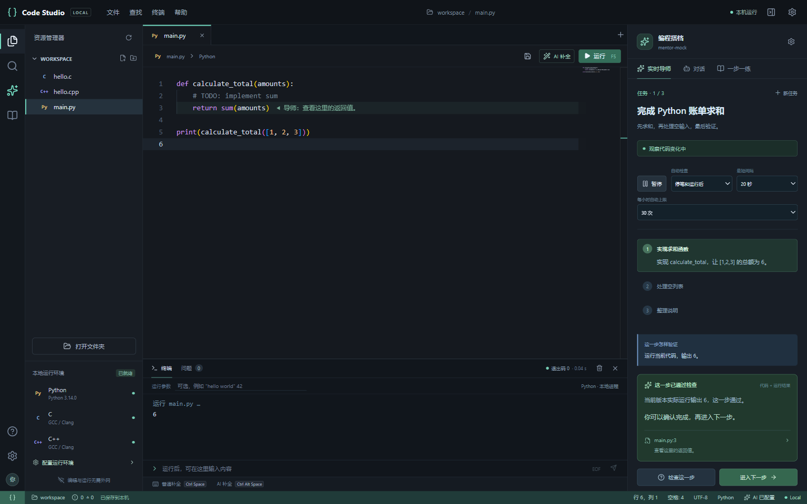

# CodeStudio

[中文](README.md) · [English](README.en.md)

Write and run code on your own computer in a browser, with an AI mentor that guides you through your projects one step at a time.

CodeStudio is a local programming workbench for Windows, built with Monaco Editor. It offers Python and C/C++ editing and execution, basic completion, and AI features with configurable API endpoints. v0.1.0 is the first public release. The interface is currently in Chinese.



## Download and start

1. Download [CodeStudio-v0.1.0-windows-x64.zip](https://github.com/RoyAdas/CodeStudio/releases/download/v0.1.0/CodeStudio-v0.1.0-windows-x64.zip), or visit the [latest Release](https://github.com/RoyAdas/CodeStudio/releases/latest). GitHub's “Source code” archives are for development, not the ready-to-run package.
2. **Extract the entire archive** into a writable folder. Do not run it inside the ZIP or copy only the launcher.
3. Double-click `Start.cmd` or `启动工作台.cmd`. Your browser will open the local workbench.

The package includes Node, so you do not need npm or an editor download to start it. Install **Python, GCC/G++, or Clang/Clang++ separately** to execute those languages. Open “设置 → 运行环境” (Settings → Runtime) to check detection or enter full tool paths. You configure your own AI service; editing and execution do not require one.

The default address is `http://127.0.0.1:8765`. If the port is occupied, the launcher selects another available port; use the address it opens. Double-click `Stop.cmd` or `停止工作台.cmd` to stop the service. Closing the browser leaves the background service running.

v0.1.0 supports **Windows x64**. macOS, Linux, mobile devices, and public hosting are outside this release's supported scope.

## Features and scope

- Open local projects, manage files, edit and save code, and restore unsaved browser drafts.
- Run single-file Python, C, C++, and JavaScript programs with real output, exit codes, and compiler errors. Standard input, cancellation, and execution time limits are supported.
- Complete Python/C/C++ keywords, snippets, and identifiers from the current file.
- Request AI completion, code explanations, or help with runtime errors. Completion suggestions require your approval before insertion.
- Give the task mentor a project goal. It generates a route with a goal, hint, and verification method for each step.
- Check code after about 5 seconds without typing and after execution finishes. Automatic requests are at least 20 seconds apart and limited to 30 per hour by default. Change the limits, pause, or switch to manual checking. You choose when to advance after a successful review.

This is not a complete VS Code replacement. Extension marketplaces, breakpoint debugging, language-server semantic completion, CMake, and multi-file builds are not included. C uses C11 and C++ uses C++17; each compile builds one source file.

## Try your first exercise

Open the included `examples` folder, select `main.py`, `hello.c`, or `hello.cpp`, and press **F5** to save and run. `input_demo.py` demonstrates terminal input.

After configuring AI, enter a goal in “实时导师” (Live Mentor), for example:

> Build a small expense tracker in Python. I know variables, loops, and functions. Give me one small task at a time, provide a hint first, and then review my code.

Submit the task and write the code yourself. Reviews send code to your configured service. Pause the mentor or select “只手动检查” (Manual only) if you do not want automatic transmission. Model responses take additional time: 5 seconds is the typing-idle delay, not a response-time guarantee.

See the [usage guide](docs/usage.en.md) and [task mentor guide](docs/mentor.en.md).

## Configure your AI service

In “设置 → AI 服务” (Settings → AI Service), enter the **API URL, protocol, model name, and key**. Chat Completions, Responses, and Anthropic Messages are supported, allowing compatible relays, DeepSeek, or a local Ollama service. Enable the no-key option for endpoints that do not require authentication.

Use the exact URL and model name supplied by your provider. Protocol adapters have local mock coverage, but providers differ in network access, model permissions, parameters, and response formats. **Not every real service has been verified.** “测试连接” (Test connection) makes a short request that may incur a charge. Automatic mentor reviews also consume API quota. Hourly limits apply only to automatic reviews; manual requests may still incur charges. Token counts come from provider responses, may be unavailable, and are not a billing statement.

## Privacy and execution permissions

- Editor assets are served locally, and the server listens only on `127.0.0.1`. Editing, ordinary completion, and code execution do not call AI.
- AI chat and completion send relevant context when requested. **After starting a mentor task, enabled automatic reviews send code snapshots.** The mentor may include up to 6 open files, about 36,000 characters, selected text, your task, and execution output. It excludes common sensitive filenames such as `.env`, but does not redact content; secrets in code or output may still be sent. Pause the mentor or remove such content first. See the [mentor guide](docs/mentor.en.md) for exact filename rules.
- Keys are encrypted locally with Windows DPAPI under your Windows account and stored in `data/`. Enter them again after switching computers or accounts. Configuration, task history, and logs are also local; do not commit `data/` to GitHub.
- Programs execute with your current Windows account's permissions. **This is not an isolated code sandbox.** Run trusted code and do not expose the workbench to the public internet.
- AI feedback is model judgment, not a substitute for actual tests. The mentor does not automatically install dependencies, execute arbitrary commands, or overwrite code.

## Develop from source

Install a supported Node.js version (see `engines` in `package.json`) and npm, then run these commands at the repository root:

```sh
npm ci
npm run build
npm start
```

Open the local address shown on startup. `npm start` serves the built interface; rebuild after changing frontend code.

Validation and Windows packaging:

```sh
npm run typecheck
npm test
npm run test:e2e
npm run package:win
```

Before the first end-to-end test, install its browser with `npx playwright install chromium`. Tests use a local mock AI service and do not need real API keys. Windows packaging creates a ZIP with a Node runtime; the packaging script reports its output location.

Only source code, examples, and documentation belong in the repository. Do not commit local `data/`, personal workspaces, runtimes, or build output. See [CONTRIBUTING](CONTRIBUTING.md).

## Feedback and roadmap

When reporting a bug, include the app version, Windows version, reproduction steps, and logs with private content removed. Do not attach API keys, the entire `data/` directory, or project code you have not reviewed for secrets.

Potential v0.2 work includes Python virtual environments, language-server completion, multi-file builds, streaming AI responses, and Chinese/English UI switching. Plans may change based on feedback. See [CHANGELOG](CHANGELOG.md) for release history.

The project is available under the [MIT license](LICENSE), authored by RoyAdas. Third-party notices are retained in [licenses](licenses/). CodeStudio is an independent project and is not officially affiliated with Microsoft VS Code, OpenAI, DeepSeek, or other providers.
