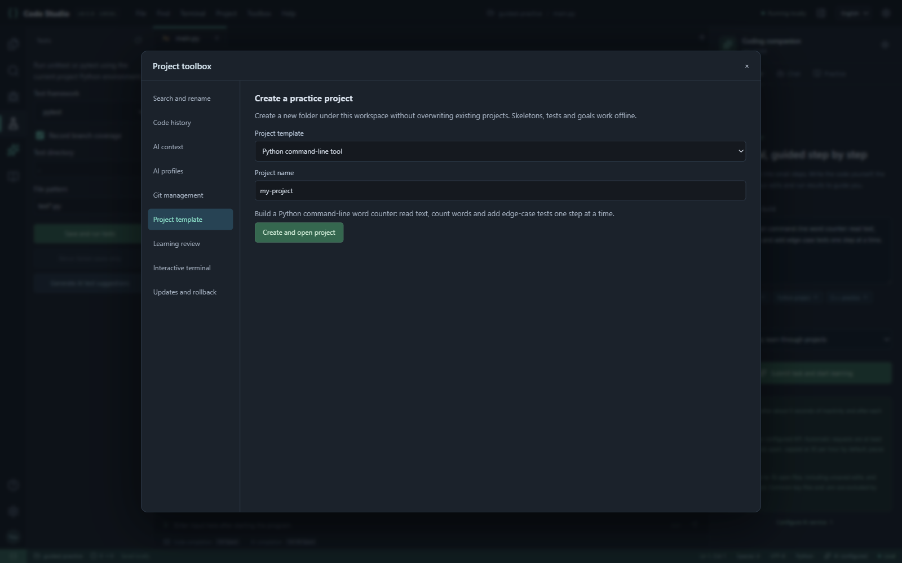

# v0.5 工具箱指南

从顶栏“工具箱”进入。小窗口也可使用编辑器工具栏上的工具箱按钮。界面支持中文与英文；退出浏览器不会停止后台工作台。

覆盖率报告会警告并跳过无法解析的未完成 Python 文件；这类文件不计入覆盖率，已执行的测试仍保留真实结果。

## 十项新增功能

1. **Git 管理**：初始化当前目录、查看状态与差异、逐文件暂存/取消、设置仓库作者、提交、查看最近 20 条历史、拉取和推送。拉取仅允许快进。远程使用本机 Git 凭据，不在工作台保存 GitHub 密码；先在交互终端设置 origin。AI 解释差异和拟提交说明只发送当前显示的差异，最多 10,000 字符；生成说明后由你编辑和提交。
2. **搜索、替换、格式化与重命名**：搜索工作区文本，可过滤路径和区分大小写。替换为普通文字匹配。Python 使用 Black，C/C++ 使用 clangd，支持的其他文件使用 Prettier。符号重命名依赖 Python/C/C++ 语言服务与当前项目配置。修改先预览，接受为草稿，保存后才写入文件。预览基线变化时拒绝应用。不是全语言、任意工程都能成功的重构引擎。
3. **本地代码历史**：每次保存记录原文件与新内容，每文件保留最近 20 份，重复快照自动合并。选择旧版本先比较，再接受并保存。历史在安装目录 data/file-history 中，按工作区与文件区分；文本每份最多 2 MB。目前不能从此面板恢复已删除文件，也没有总体磁盘配额，请定期检查空间。
4. **AI 上下文选择**：可选最多 16 个项目文件，包含未打开文件，优先使用编辑器草稿。范围检查分别显示对话与导师的文件清单、字符数。对话最多 120,000 字符、单文件 50,000 字符；导师最多 36,000 字符、单文件 18,000 字符，优先当前文件，截断条目标有省略号。当前代码、选中内容、任务、测试或运行输出可能另行发送。选择按工作区保存在本机浏览器。
5. **多套 AI 配置**：保存最多 16 套地址、协议、模型与密钥，为对话、补全、导师分别指定配置。“默认设置”沿用设置页接口；激活配置会复制为默认配置。支持兼容的 Chat Completions、Responses、Anthropic Messages。密钥用 Windows DPAPI 加密；本机、账户变化需重填。删除配置不清空此前复制到默认设置的接口。
6. **离线项目模板**：Python 文本统计、记账、pytest，C 算法和 C++ 多文件练习。创建新子文件夹，提供代码骨架、测试与学习任务，不覆盖现有文件夹；打开后任务出现在导师输入框，由你提交。练习骨架带 TODO，初始测试失败是正常的。
7. **pytest 与分支覆盖率**：测试面板选择 unittest 或 pytest，勾选覆盖率；参数化用例逐项报告，可只重跑失败用例。覆盖率标记显示执行/遗漏行，代码修改后清除旧标记。pytest 与覆盖率使用随包工具，不需要对项目执行 pip install；项目自己的依赖仍需自行安装。第三方 pytest 插件自动加载默认关闭。
8. **真正交互终端**：当前工作区启动 PowerShell，最多 6 个独立会话。支持输入和终端程序；关工具箱保留会话，切换工作区/停止工作台会关闭。终端与“运行输出”分开，使用当前 Windows 用户权限。
9. **学习复盘与错题本**：记录导师步骤、需要修改的反馈与可见页面练习时间，按工作区统计。AI 复盘是草稿，只有点“确认保存复盘”才落盘，保存于 data/learning.json。练习分钟数为页面可见期间的粗略计时，不能作为考试或学习成效证明。
10. **更新与回退**：只有点击检查时请求 GitHub；从 RoyAdas/CodeStudio 官方 Release 下载，核验 SHA256、版本与解压路径，备份设置，安装到独立 versions 文件夹。切换前保存草稿并停止运行；旧版保留。可登记其他完整安装文件夹，方便回到 v0.4.0。GitHub 访问仍取决于网络，本机编辑与启动不依赖 GitHub。

## 安装与升级

Windows 10/11 x64；交互终端需要系统 ConPTY（Windows 10 1809+）。安装包自带 Node、语言服务、debugpy、格式化与测试组件；仍需自行安装 Python 及 C/C++ 编译器。Python 格式化、pytest、覆盖率与调试需要 Python 3.10+。Git 面板需要 Git for Windows。

保存并停止旧版，把 v0.5.0 完整解压到新文件夹，双击 Start.cmd。设置 → 升级与备份可迁移原安装目录（例如 G:\CodeStudio）或导入加密备份；项目代码与虚拟环境留在原工作区。首次从 v0.4.0 手工迁移时，设置/导师/学习记录会导入，旧文件历史目录不会自动搬迁；自动更新功能会复制文件历史。密钥迁移需要同一 Windows 用户与电脑。可在新工具箱登记原安装目录作为回退版本。

设置备份包含配置、导师会话和学习记录，文件历史是独立的明文文件，不属于加密备份。历史、错题、终端输出可能含私人内容，不应上传 data。工作台不是代码隔离沙箱；只有你确认的文件修改才写入磁盘，但执行的项目代码与终端命令具有本机用户权限。

## 源码准备

首次联网安装依赖及校验过的运行组件，随后编辑与运行可离线：

    npm ci
    npm run prepare:languages
    npm run prepare:debugger
    npm run prepare:python
    npm run typecheck
    npm run build
    npm test
    npm run test:e2e
    npm run package:win
    npm run test:package

准备与打包脚本目前面向 Windows。自动化 AI 测试使用本地模拟接口，不证明所有中转站或真实模型均兼容。
